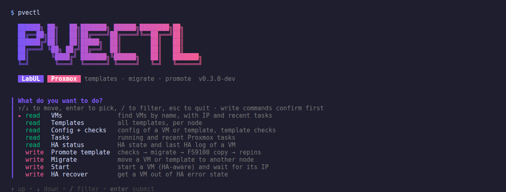
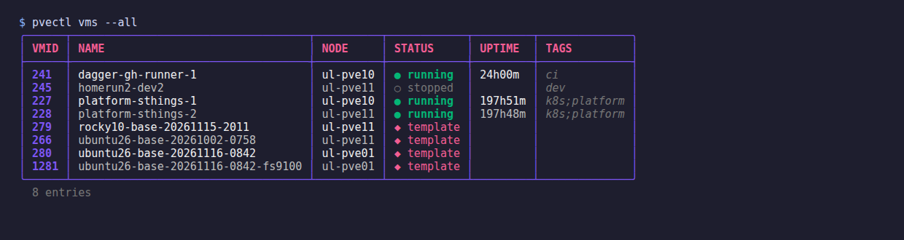
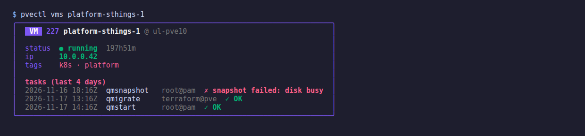
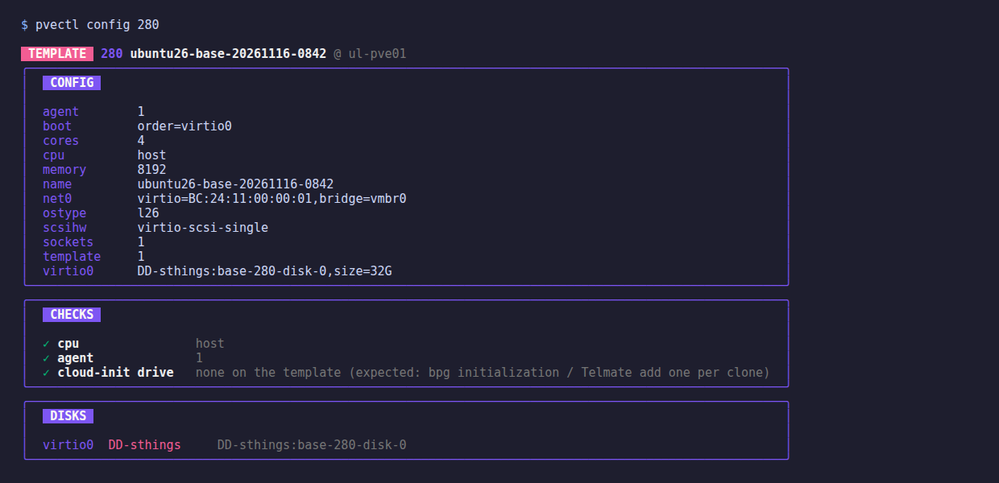
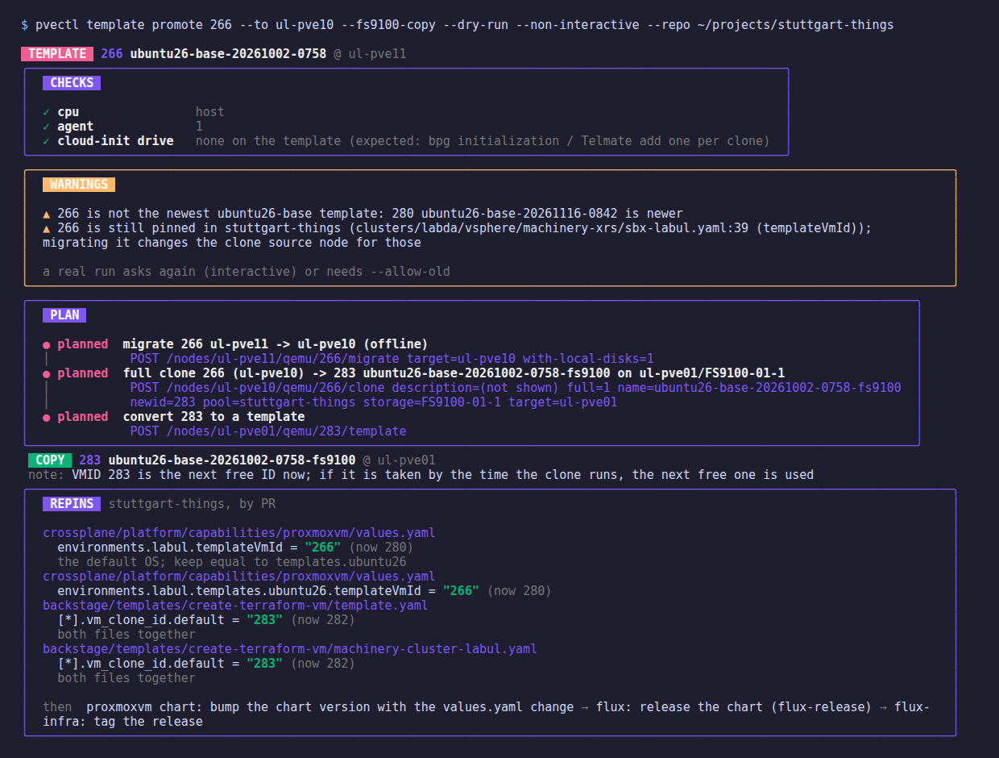

# pvectl

Go CLI and library for the LabUL Proxmox template work: find VMs and
templates, check their configs, follow tasks, migrate, and promote a fresh
Packer template (FS9100 copy for Terraform, move to ul-pve11, print the
repins). It replaces `hack/labul/pve.py` and the one-off scripts of the
2026-11 template rounds ([stuttgart-things#4652](https://github.com/stuttgart-things/stuttgart-things/issues/4652)).

<p align="center"></p>

> **VM descriptions (notes) are never printed.** In the LabUL-Template pool
> they hold plaintext passwords. The library drops `description` when it reads
> a config, and no command or flag shows it. `cipassword` shows as `(set)`.

## Install

```bash
# release binary (linux/darwin/windows, amd64/arm64)
gh release download -R stuttgart-things/pvectl -p 'pvectl_*_linux_amd64.tar.gz' -O - | tar xz pvectl
install -m 0755 pvectl ~/.local/bin/

# or from source
go install github.com/stuttgart-things/pvectl@latest

# container image (for Dagger/Tekton): ghcr.io/stuttgart-things/pvectl
```

Once per machine, trust the Proxmox certificate (since v0.4.0; see
[TLS without `--insecure`](#tls-without---insecure)):
```bash
sops exec-env ~/.secrets.d/labul/proxmox.env 'pvectl tls trust'
```

## Credentials

From the environment only, never printed, never stored:

| Variable | |
|---|---|
| `PVE_API_URL` | `https://<host>:8006/api2/json` |
| `PVE_API_USER` | `user@realm` (ticket login, user/password) |
| `PVE_API_PASSWORD` | |
| `PVE_API_TOKEN_ID` | instead of user/password: an API token `user@realm!tokenname` (CI, Dagger). Set, it is used instead of user/password |
| `PVE_API_TOKEN_SECRET` | the token secret |
| `PVE_CA_CERT` | optional: the cluster CA (`/etc/pve/pve-root-ca.pem` on any node), a file path or the PEM itself |
| `PVE_KNOWN_HOSTS` | optional: the file of pinned certificates (default `~/.config/pvectl/known_hosts`) |

An API token with privilege separation has only the permissions granted to
the token itself (Datacenter > Permissions > API Token Permissions). Give
it what the commands you run need, e.g. the template pool and storages for
`template promote`. A 401 names the token variables to check.

```bash
sops exec-env ~/.secrets.d/labul/proxmox.env 'pvectl vms ubuntu26'
```

### TLS without `--insecure`

TLS is always verified, in this order:

1. **CA**: the system store or `PVE_CA_CERT`. Proxmox signs node certificates
   with its own cluster CA (`/etc/pve/pve-root-ca.pem`, valid for 10 years).
   This option survives certificate renewals.
2. **Pinned certificate**, like SSH `known_hosts`. Pin it once:

   ```bash
   sops exec-env ~/.secrets.d/labul/proxmox.env 'pvectl tls trust'
   ```

   It shows the SHA-256 of the node certificate. Compare it with the web UI
   (node > System > Certificates, `pve-ssl.pem`) and confirm. The first
   interactive run of any command offers this by itself. From then on,
   pvectl accepts exactly this certificate for this host, and stops with
   `CHANGED` if it is ever different (after a renewal, run `tls trust`
   again). Programmatic: `pvectl tls trust --fingerprint AB:CD:…` (checked
   against the server) or `--yes`.
3. `--insecure` skips the check for one run. Use it only as a last resort.

`pvectl tls` shows the certificate and its state: `ca`, `pinned`, `changed`
or `untrusted`.

## Two modes, same logic

The commands are thin surfaces over the library in `pkg/`. A run is
**interactive** when stdin and stdout are a TTY, there is no `-o json`, and
there is no `--non-interactive`. Otherwise it is **programmatic**.

| | interactive (human at a terminal) | programmatic (script, CI, Dagger/Tekton, AI agent) |
|---|---|---|
| missing input | asked for: VM/template from a filterable list, target node, storage | error naming the flag (exit 2, `"flag": "--vmid"` in JSON) |
| writes | summary + confirmation (`--yes` skips it) | need `--yes`, or `--dry-run` for the plan |
| long tasks | spinner, progress bar from the task log (`(x%)`), last log line | log lines on stderr |
| output | readable text | `-o json`: one JSON document on stdout, logs/progress on stderr |
| `pvectl` alone | start menu: logo, all commands, read/write marked | the help |

### The terminal look

On a terminal, text output gets cards, colored tables and badges
([Charm](https://charm.sh) lipgloss/huh/bubbletea). Piped text output stays
plain and grep-able, as before; `-o json` is never styled. Long lines wrap to
the terminal width.

| `vms` | `vms <name>` |
|---|---|
|  |  |
| **`config`** | **`template promote --dry-run`** |
|  |  |

(Screenshots from a fake API with made-up data.)

Every prompt has a flag counterpart. `pvectl <cmd> --help` shows examples
for both modes.

## Commands

| Command | | Writes? |
|---|---|---|
| `vms [filter]` | VMs (`--templates`, `--all`) by name substring or VMID; with a filter also guest IPv4 and the `qm*`/`ha*` tasks of the last 4 days (`--days`) | no |
| `config [vmid]` | config without description, disks, checks: cpu (`host` or `x86-64-v3`+), guest agent, cloud-init drive | no |
| `tasks` | recent tasks (cluster, or `--node`/`--vmid`/`--type`/`--errors`/`--since`) | no |
| `tasks --follow <upid>` | follow a task until it stops; exit 5 if it failed | no |
| `ha [<node>] [vmid]` | HA resource and state, recent tasks, log of the last start/migrate | no |
| `repin` | the stuttgart-things values for a new template/copy VMID | no |
| `tls` | the API certificate (subject, names, expiry, SHA-256) and its trust state; no login | no |
| `tls trust` | pin the API certificate in the known-hosts file; `--fingerprint` (checked against the server) or `--yes` | local file only |
| `migrate [<node> <vmid> <target>]` | online if running, with local disks if any, waits for the task (under HA: until the guest is on the target); `--targetstorage` | yes |
| `template promote [vmid]` | checks → migrate `--to` → FS9100 copy `--fs9100-copy` → repins | yes |
| `start [<node>] [vmid]` | start a stopped VM, wait for its IP; refuses on HA `error` | yes |
| `ha-recover [<node>] [vmid]` | HA `error` → `disabled` → `started`, wait for the IP (#4240) | yes |

Every write command has `--dry-run` (the plan: API calls, new VMID/name;
nothing is written) and `--yes`. A description parameter shows as
`(not shown)` in a plan.

### config checks

| Check | Why |
|---|---|
| `cpu` = `host`, `x86-64-v3` or `x86-64-v4` | EL10 needs x86-64-v3; the Packer plugin did not always carry `cpu_type` through (#4650). A guest with a non-Linux `ostype` (Windows, DDVE: `win*`, `other`) only gets a **warning**: the Proxmox default `x86-64-v2-AES` is fine there and keeps live migration across CPU generations. An unset `ostype` counts as Linux |
| `agent` enabled | without it Proxmox never learns the guest IP |
| cloud-init drive | a VM without one keeps the template hostname. On a **template** a missing drive passes: none of the LabUL templates (211, 266, 280, 282) has one, because bpg (`initialization`) and Telmate add one to every clone |

A failed check exits with 4. Warnings do not.

### template promote

```text
Packer (ul-pve01) ──> 1. checks ──> 2. migrate --to ul-pve11 ──> 3. --fs9100-copy ──> 4. repins (printed)
```

1. **checks**: as in `config`. A failure stops the run (exit 4) unless you pass `--skip-checks`.
   **Warnings** guard against promoting the wrong template: a newer template of the same OS exists
   (by the build stamp `-YYYYMMDD-HHMM` in the name), or, with `--repo`, the source is still pinned
   (`templateVmId`/`vm_clone_id` in claims, XRs, backstage runs) and would be migrated. With warnings
   a run asks a second time (interactive, default no) or needs `--allow-old` (exit 4 without it).
   `--dry-run` shows them and exits 0.
2. **migrate**: the template moves to `--to` (ul-pve11), so the proxmoxvm chart can leave `templateNode` empty.
3. **FS9100 copy**: a full clone `<name>-fs9100` with `storage=FS9100-01-1`, `target=ul-pve01` and
   `pool=stuttgart-things`, which is then converted to a template. Telmate Terraform (create-terraform-vm)
   sends no `storage` on clone and gets 403 (`Datastore.AllocateSpace`) on DD-sthings, so it clones the
   copy. These are the same calls as `pve-fs9100-copy.py`, which made 282 on 2026-11-16.
4. **repins**: printed, not applied. The PRs are made by hand:
   - `crossplane/platform/capabilities/proxmoxvm/values.yaml`: `templateVmId` (ubuntu26: `environments.labul.templateVmId` and `templates.ubuntu26.templateVmId`; other OSes only `templates.<os>.templateVmId`). Then bump the chart, make a flux release and tag flux-infra.
   - `backstage/templates/create-terraform-vm/{template.yaml,machinery-cluster-labul.yaml}`: the `vm_clone_id` default, in both files together.

   `--repo <stuttgart-things checkout>` adds the current values.

The command is **idempotent**. A template that is already on `--to` is not
migrated again, and a copy that already exists by name is reported instead
of cloned twice. After a failure, run the same command again. Old templates
that are still pinned (211, 266) are never touched: promote only migrates
its source and creates the copy.

```bash
E=~/.secrets.d/labul/proxmox.env
sops exec-env $E 'pvectl template promote 290 --to ul-pve11 --fs9100-copy --dry-run'
sops exec-env $E 'pvectl template promote 290 --to ul-pve11 --fs9100-copy --repo ~/projects/stuttgart-things'
# CI / agent
sops exec-env $E 'pvectl template promote 290 --to ul-pve11 --fs9100-copy --yes -o json' | jq '.plan.repins'
```

## JSON contract (`-o json`)

- stdout carries exactly one JSON document: an array for `vms`/`tasks`, an
  object otherwise. Logs, task log lines and progress go to stderr.
- Errors are JSON too: `{"error": "...", "code": 2, "kind": "usage", "flag": "--vmid"}`.
  `flag` is set when a missing or invalid flag caused the error.
- Commands that produced a result and still fail print the result, not an
  error object, and signal the failure through the exit code. Examples: `config` with a failed check (exit 4),
  `vms` without a match (`[]`, exit 3), `promote`/`migrate` after a failed
  task (`"state": "failed"`, `error` set, exit 5).

## Exit codes

| Code | Kind | Meaning |
|---|---|---|
| 0 | | ok, including "nothing to do" |
| 1 | `error` | API or network error; TLS: certificate `untrusted` (run `pvectl tls trust`) or pinned one `CHANGED` |
| 2 | `usage` | bad or missing flag/argument, missing environment, write without `--yes` in programmatic mode, `tls trust` without `--fingerprint`/`--yes` |
| 3 | `not_found` | VM, template, node or task not found; `vms` without a match |
| 4 | `check_failed` | config check failed, the promote source is not a template, a promote with warnings without `--allow-old`, or `tls trust --fingerprint` does not match the server |
| 5 | `task_failed` | a Proxmox task ended with an error |
| 130 | `aborted` | aborted at a prompt or by Ctrl+C (Ctrl+C while following a task detaches; the task keeps running) |

## Library

```go
import (
    "github.com/stuttgart-things/pvectl/pkg/pve"      // client, configs (no description), checks, tasks, migrate, clone, rename, delete, HA, networks, storages
    "github.com/stuttgart-things/pvectl/pkg/promote"  // Build (plan, read-only) and Execute
    "github.com/stuttgart-things/pvectl/pkg/repin"    // the stuttgart-things changes after a promotion
)

o, _ := pve.OptionsFromEnv()
c, _ := pve.New(o)
plan, err := promote.Build(ctx, c, promote.Options{SourceID: 290, To: "ul-pve11", Copy: true})
```

Without a known-hosts file (a pipeline), pin the certificate in memory:

```go
k, _ := pve.PinnedKnownHosts(url, "33:91:DF:48:…")
c, _ := pve.New(pve.Options{URL: url, TokenID: id, TokenSecret: secret, KnownHosts: k})
r, _ := c.FindByName(ctx, "ubuntu26-labul-proxmox-base-os", "LabUL-Template", "")
```

`pkg/pve/pvetest` is a fake Proxmox API for tests.

## Dagger

The [pvectl Dagger module](https://github.com/stuttgart-things/dagger/tree/main/pvectl)
runs this CLI from `ghcr.io/stuttgart-things/pvectl` with an API token and a
pinned fingerprint (or `--ca-cert`):

```bash
E=~/.secrets.d/labul/proxmox.env
M=github.com/stuttgart-things/dagger/pvectl@v0.140.0
FP=33:91:DF:48:E5:34:B2:BC:76:AD:5C:92:AE:DB:8E:7D:3B:17:6D:A1:45:41:2C:44:12:1F:C1:EB:9D:65:57:13
CONN="--url \$PVE_API_URL --fingerprint $FP --token-id env:PVE_API_TOKEN_ID --token-secret env:PVE_API_TOKEN_SECRET"

# templates
sops exec-env $E "dagger call -m $M $CONN vms --templates" | jq -r '.[] | "\(.vmid) \(.node) \(.name)"'

# promote plan (nothing is written), with the current repins from a checkout
sops exec-env $E "dagger call -m $M $CONN template-promote --vmid 290 --repo ~/projects/stuttgart-things" | jq .plan

# carry it out
sops exec-env $E "dagger call -m $M $CONN template-promote --vmid 290 --apply" | jq .plan.repins
```

The fingerprint is the one of `ul-pve01.labul.sva.de` until 2028-01-28;
`pvectl tls` shows the current one.

## From pve.py

| pve.py | pvectl |
|---|---|
| `pve.py vms <filter>` | `pvectl vms <filter>` |
| `pve.py ha <node> <vmid>` | `pvectl ha <node> <vmid>` |
| `pve.py start <node> <vmid>` | `pvectl start <node> <vmid>` |
| `pve.py ha-recover <node> <vmid>` | `pvectl ha-recover <node> <vmid>` |
| `pve.py migrate <node> <vmid> <target> [--targetstorage S]` | `pvectl migrate <node> <vmid> <target> [--targetstorage S]` |
| `pve.py --insecure …` | `pvectl …` after a one-time `pvectl tls trust` |
| `pvecfg`, `pve199`, `pvefind`, `pvetpl`, `pvetask`, `pve-fs9100-copy` | `config`, `vms --templates`, `tasks --follow`, `template promote --fs9100-copy` |

Writes now need a confirmation or `--yes`. pve.py wrote without asking.

## Development

```bash
task test          # go test ./... in Dagger (the dev sandbox breaks the Go linker for go test)
task build-local   # ./bin/pvectl with version info
task smoke         # read-only checks against LabUL through sops
```

Releases come from the Release workflow (semantic-release + GoReleaser + ko)
once "Go Lint, Test & Build" and the image build are green on `main`. PR
titles must be Conventional Commits.
